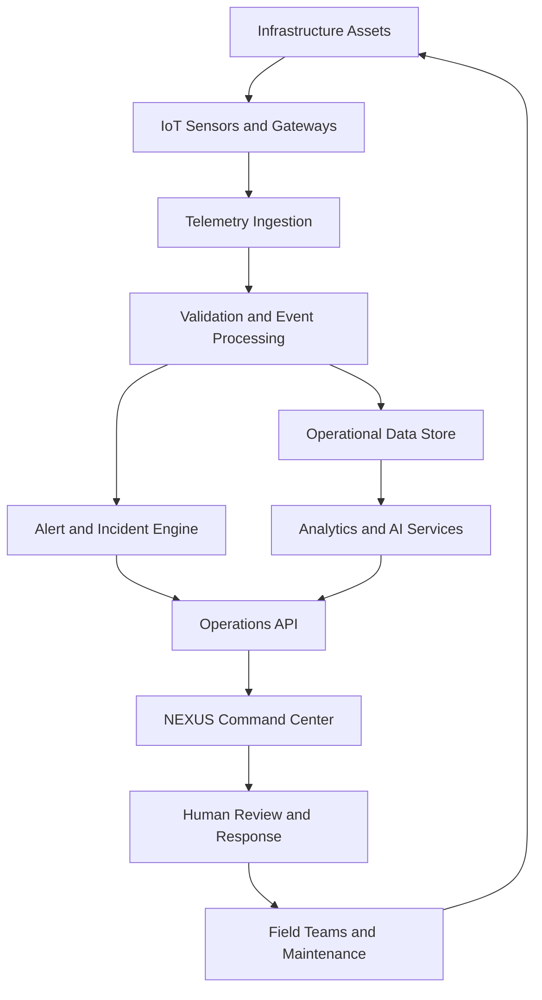

# NEXUS · Infra Command Center

### Intelligent Infrastructure. Regenerative Communities.

**NEXUS Infra** is a unified infrastructure monitoring and operations platform designed to help communities, municipalities, and infrastructure operators monitor, optimize, and coordinate essential services across water, energy, waste management, IoT sensors, and emergency response systems.

Built around a regenerative infrastructure vision, NEXUS combines real-time telemetry, geospatial intelligence, predictive maintenance, resource optimization, and AI-assisted decision support into a unified command center.

> **Mission:** Make critical infrastructure more resilient, efficient, transparent, and responsive to the communities it serves.

---

## 🌍 Overview

The NEXUS Command Center provides a consolidated operational view of distributed infrastructure networks, beginning with a proposed Kibera regenerative pilot.

Operators can monitor system health, identify emerging incidents, inspect infrastructure assets, review resource flows, and prioritize interventions based on risk and community impact.

### Core Capabilities

- **Real-time monitoring:** Aggregate operational data from infrastructure assets and connected sensors.
- **Geospatial intelligence:** Visualize pipelines, solar installations, waste routes, sensor clusters, and active incidents.
- **Predictive maintenance:** Identify equipment degradation and prioritize inspections before failures occur.
- **AI-assisted operations:** Generate recommendations for resource allocation, route optimization, and infrastructure stabilization.
- **Emergency operations:** Track critical alerts and coordinate incident response.
- **Resource optimization:** Analyze water distribution, energy generation, storage capacity, and waste collection.
- **Community-centered resilience:** Prioritize infrastructure reliability according to population needs and service criticality.

---

## 🖥️ Command Center Dashboard

The dashboard brings essential infrastructure indicators into a single operational interface.

| Indicator | Illustrative Value | Description |
|---|---:|---|
| Composite Health | 89.4/100 | Weighted infrastructure performance score |
| Water Flow | 412 m³/h | Aggregate monitored water throughput |
| Solar Output | 284 kW | Current solar generation |
| Battery Reserve | 76% | Available battery state of charge |
| Sensors Online | 1,284/1,312 | Connected monitoring devices |
| Open Alerts | 14 | Active incidents requiring attention |

**Note:** These figures represent the supplied dashboard concept and are illustrative, not verified live infrastructure telemetry. Real operational use requires connected data sources, validated measurements, and an appropriate monitoring and alerting pipeline.

---

## 🧭 Platform Modules

### 1. Overview
A unified view of infrastructure health, live events, key performance indicators, and operational recommendations.

### 2. Water Intelligence
Monitor water distribution networks, flow rates, pipeline conditions, pump performance, and suspected leaks.

**Key functions**
- Flow and pressure monitoring
- Leak and rupture detection
- Pump performance tracking
- Water-loss analysis
- Maintenance prioritization

### 3. Energy Intelligence
Monitor renewable generation, microgrids, transformers, and battery storage.

**Key functions**
- Solar generation monitoring
- Battery state-of-charge tracking
- Load and voltage monitoring
- Microgrid stability alerts
- Energy demand forecasting
- Distributed power optimization

### 4. Waste Operations
Coordinate waste collection, service routes, collection points, and operational efficiency.

**Key functions**
- Waste collection tracking
- Overflow-risk detection
- Route optimization
- Vehicle utilization monitoring
- Fuel and time efficiency analysis
- Collection performance reporting

### 5. Sensor Network
Manage connected devices and infrastructure telemetry.

**Key functions**
- Online and offline device tracking
- Sensor health monitoring
- Latency and connectivity alerts
- Data-quality validation
- Device inventory and diagnostics

### 6. Predictive Maintenance
Move infrastructure maintenance from reactive repairs toward condition-based intervention.

**Key functions**
- Equipment health assessment
- Failure-risk estimation
- Maintenance scheduling
- Asset lifecycle monitoring
- Work-order prioritization

### 7. Emergency Operations
Provide incident awareness and coordination across infrastructure services.

**Key functions**
- Severity-based incident classification
- Asset and zone identification
- Incident status tracking
- Response coordination
- Escalation workflows
- Incident history and post-event analysis

### 8. Analytics
Translate infrastructure telemetry into actionable operational intelligence.

**Key functions**
- Historical trend analysis
- Resource-flow visualization
- System health scoring
- Performance benchmarking
- Reliability and uptime reporting
- Environmental impact estimation

---

## 🗺️ Live Infrastructure Map

The geospatial interface is designed to display critical infrastructure assets and operational events across the pilot area.

**Map layers**
- Water pipelines and pumping stations
- Solar installations and microgrid nodes
- Battery storage systems
- Waste collection routes and collection hubs
- Sensor clusters and network health
- Active incidents and infrastructure alerts

The map should support asset selection, zone filtering, incident inspection, and access to relevant telemetry and maintenance history.

Geospatial data can also support infrastructure planning by revealing service gaps, resource constraints, and areas that require additional investment.

---

## 🚨 Real-Time Alerts

NEXUS organizes infrastructure incidents according to service category, severity, location, and response priority.

### Illustrative Alert Feed

| Incident | Category | Severity |
|---|---|---|
| Pipe rupture detected · Sector B-19 | Water | Critical |
| Transformer T-9 approaching 92% load | Energy | High |
| Waste bin overflow risk · Laini hub | Waste | Medium |
| Sensor F-3 latency spike | IoT | Low |
| Microgrid C-2 frequency deviation | Energy | Critical |

### Alert Lifecycle

1. **Detect:** Receive telemetry, threshold events, or operator reports.
2. **Validate:** Check data quality and confirm the event where required.
3. **Prioritize:** Evaluate severity, service disruption, and community impact.
4. **Respond:** Assign the incident to the appropriate operations team.
5. **Resolve:** Record corrective actions and restoration status.
6. **Learn:** Analyze the incident to improve reliability and preventive controls.

Critical infrastructure actions should retain human oversight, particularly when recommendations affect water access, electrical distribution, public safety, or emergency response.

---

## 🤖 AI-Assisted Operations

NEXUS is designed to convert operational data into recommendations that help teams make better-informed decisions.

### Illustrative Recommendations

**Energy redistribution**

Redistribute 18 kW from Soweto East to Zone B.

*Intended outcome:* Stabilize voltage and improve local power balance, subject to network constraints and operator approval.

**Predictive pump maintenance**

Prioritize inspection of pump P-22 based on its estimated failure risk.

*Intended outcome:* Detect emerging faults before service is interrupted.

**Waste collection optimization**

Evaluate an alternative route for waste truck #4 via Olympic Road.

*Intended outcome:* Reduce travel time and fuel consumption while maintaining service coverage.

**Battery preparation**

Evaluate pre-charging batteries ahead of the afternoon demand peak.

*Intended outcome:* Improve reserve capacity during periods of elevated demand.

Recommendations should include supporting evidence, confidence estimates, relevant constraints, and an explanation of their expected impact. Any numerical savings or failure probabilities must be validated against actual operating data before being treated as achieved outcomes.

---

## 📊 Resource Flow Analytics

The analytics layer is intended to track how essential resources move through the infrastructure network.

| Resource | Primary Measurements |
|---|---|
| Water | Flow rate, pressure, leakage, distribution availability |
| Energy | Solar output, demand, battery reserves, grid stability |
| Waste | Collection volume, route completion, overflow risk |
| Sensors | Uptime, latency, connectivity, data quality |

### System Health

The proposed system health model combines service-specific indicators with infrastructure criticality and population impact.

| Domain | Illustrative Score |
|---|---:|
| Water | 92 |
| Energy | 87 |
| Waste | 78 |
| Sensors | 96 |

A production scoring model should document its weighting methodology, missing-data handling, scoring intervals, and treatment of critical failures. A high aggregate score must never conceal an active safety-critical incident.

### Additional Operational Indicators

- Water leaks detected within a reporting window
- Peak solar generation versus forecast
- Waste collection volume and completed routes
- Sensor uptime and degraded-device counts
- Mean time to acknowledge and resolve incidents
- Infrastructure availability and service interruptions

---

## 🏗️ Proposed Technical Architecture

NEXUS can be implemented as a modular platform that separates data ingestion, operational processing, geospatial visualization, and user-facing applications.

### Architecture Layers

**1. Infrastructure layer**
Pipelines, pumps, meters, solar panels, batteries, transformers, waste vehicles, and environmental sensors.

**2. Connectivity layer**
IoT gateways, device protocols, secure communications, and intermittent-connectivity handling.

**3. Data layer**
Telemetry ingestion, time-series storage, asset registries, geospatial records, validation, and historical data retention.

**4. Intelligence layer**
Rules-based alerting, forecasting, anomaly detection, predictive maintenance, and decision-support models.

**5. Application layer**
Dashboard, GIS interface, alert center, analytics, work orders, and emergency operations.

**6. Governance and security layer**
Authentication, role-based access, audit logs, data protection, model monitoring, and safety controls.

This architecture is a proposed implementation blueprint rather than a description of an already deployed technology stack.

---

## 🔐 Security and Reliability

Infrastructure operations require dependable data and carefully controlled access.

NEXUS should incorporate:

- Role-based access control and secure authentication
- Encryption in transit and at rest
- Audit trails for alerts, decisions, and operational changes
- Device identity and secure telemetry ingestion
- Data validation and stale-data detection
- Backup, recovery, and service-continuity procedures
- Human approval for consequential control actions
- Monitoring for AI recommendation quality and drift

The platform should distinguish between **observed data, estimated values, simulated telemetry, and AI-generated recommendations** so operators can tell what is measured from what is inferred.

---

## 🌱 Regenerative Infrastructure Vision

NEXUS is intended to support an infrastructure model in which operational efficiency contributes to wider environmental and community resilience.

Potential long-term impact areas include:

- Reduced water loss and improved service reliability
- Better use of distributed renewable energy
- Lower fuel consumption in waste collection
- Reduced equipment downtime and avoidable replacement
- Improved visibility into infrastructure access and service gaps
- Better coordination of emergency response
- Evidence-based infrastructure investment

Environmental indicators, including CO₂ avoided, should be calculated using documented baselines, transparent emissions factors, clearly defined reporting periods, and auditable assumptions.

The platform should measure actual outcomes rather than treating projected savings as verified impact.

---

## 🛣️ Development Roadmap

### Phase 1 · Operational Foundation
- [ ] Establish asset and zone registry
- [ ] Build the command center dashboard
- [ ] Implement water, energy, waste, and sensor KPI cards
- [ ] Create an interactive infrastructure map
- [ ] Develop alert classification and incident tracking
- [ ] Clearly label demonstration and live data

### Phase 2 · Live Data Integration
- [ ] Integrate available meters, sensors, and operational systems
- [ ] Implement telemetry validation and timestamp monitoring
- [ ] Add historical data and trend analysis
- [ ] Connect asset status to maintenance records
- [ ] Implement authentication and audit logging

### Phase 3 · Operational Intelligence
- [ ] Introduce anomaly detection
- [ ] Develop equipment health indicators
- [ ] Add demand forecasting and resource optimization
- [ ] Provide explainable AI-generated recommendations
- [ ] Add operator review and recommendation feedback

### Phase 4 · Regenerative Impact
- [ ] Establish baseline environmental and service indicators
- [ ] Calculate verified water, energy, and emissions outcomes
- [ ] Measure service coverage and reliability
- [ ] Publish impact reports with transparent methodology
- [ ] Evaluate pilot performance before expansion

---

## 🎯 Initial Pilot: Kibera

The Kibera regenerative pilot is the proposed starting point for testing an integrated infrastructure operations model in a dense urban environment.

The pilot should begin with a defined set of assets, participating service providers, reliable baseline measurements, and a narrow operational objective.

Potential starting use cases include water-leak monitoring, solar and battery visibility, waste collection coordination, and sensor network reliability.

Implementation should proceed in partnership with relevant community representatives, infrastructure operators, and local authorities. Data collection, mapping, and intervention planning should respect privacy, community priorities, and the reliability of local infrastructure records.

Pilot success should be evaluated using measurable changes in service availability, incident response, operational cost, resource efficiency, and environmental performance.

---

## 🤝 Contributing

Contributions that improve infrastructure reliability, accessibility, data integrity, and responsible automation are welcome.

Suggested contribution areas:

- Frontend dashboard and visualization
- Geospatial mapping and asset management
- IoT integrations and telemetry pipelines
- Alerting and incident management
- Analytics and forecasting
- Security, testing, and documentation
- Environmental impact accounting

Before submitting a change:

1. Explain the problem the contribution addresses.
2. Document relevant assumptions and data requirements.
3. Include tests for important logic.
4. Avoid exposing credentials, private infrastructure data, or sensitive location information.
5. Document operational risks and failure modes.

Contribution guidelines, issue templates, and project licensing can be added as the repository matures.

---

## 📜 License

A license has not yet been specified. Add a `LICENSE` file before publishing the repository for external reuse.

---

## NEXUS · Infra

**Infrastructure intelligence for a more resilient, regenerative future.**

Monitor the network. Understand the system. Coordinate the response. Measure the impact.
